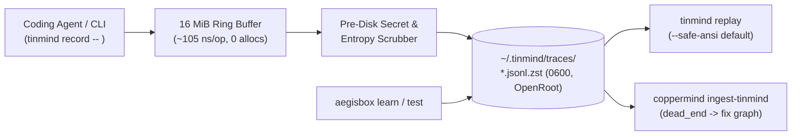

# `tinmind` (`bonjoski/tinmind`)

[](https://github.com/bonjoski/tinmind/actions/workflows/ci.yml)
[](https://github.com/bonjoski/tinmind/actions/workflows/paved-road.yml)
[](https://github.com/bonjoski/tinmind/actions/workflows/codeql.yml)
[](https://github.com/bonjoski/tinmind/releases)
[](https://golang.org)
[](https://slsa.dev)
[](https://docs.sigstore.dev)
[](LICENSE)
[-blueviolet.svg)](#security--operational-guarantees)

> [!NOTE]
> **Developer Tooling & Safe Harbor Scope:** `tinmind` is a 100% local, single-developer workstation utility built on standard OS PTY and filesystem primitives with zero cloud backends, zero network sockets, and zero enterprise fleet telemetry.

> **Sovereign Local PTY Flight Recorder & Deterministic TTY Replay for Autonomous Coding Agents.**  
> *The Feruchemical twin to [`coppermind`](https://github.com/bonjoski/coppermind): while `coppermind` stores long-term knowledge, `tinmind` captures raw sensory PTY streams and replays them safely on demand.*



- **Sub-0.05ms PTY Hot Path:** Non-blocking 16 MiB circular ring buffer decouples terminal I/O from compression and disk I/O — child sessions never stall.
- **Pre-Disk Secret Redaction:** Scrubs API keys, PEM blocks, Bearer/JWT tokens, and high-entropy secrets (`>4.2 bits/char`) *before* bytes touch disk (`0600` inside `0700` `os.OpenRoot`).
- **Safe-ANSI Replay by Default:** Strips `OSC-52` clipboard writes, DCS/APC/PM sequences, C1 controls, and Unicode Bidi overrides while keeping terminal colors intact.
- **Ecosystem Native:** Replays [`aegisbox`](https://github.com/bonjoski/aegisbox) traces (`~/.flightdeck/traces/*.jsonl`) out of the box, exports `<=16 MiB` post-mortems straight into `coppermind ingest-flightdeck`, and emits `BLPR-v1` DSSE receipts.
- **100% Local Safe Harbor:** Zero network sockets, zero cloud telemetry, zero Touch ID stalls across $N=8$ parallel worktrees.

---

## Install

```bash
brew install bonjoski/tap/tinmind
```

Or build from source (Go 1.27+):

```bash
go install github.com/bonjoski/tinmind/cmd/tinmind@latest
```

---

## 💡 Core Use Cases & Recipes

### 1. Record Any Coding Agent or Build Loop

```bash
# Record an interactive agent or test run (strict '--' delimiter prevents flag smuggling)
tinmind record -- go test ./...
tinmind record --session-id feat-auth -- claude
```

### 2. Replay a Derailed Session or `aegisbox` Kata Trace Safely

```bash
# List recent recordings (including legacy ~/.flightdeck/traces from aegisbox)
tinmind list

# Fast-forward replay at 2x speed (Safe-ANSI strips OSC-52 clipboard attacks by default)
tinmind replay tm-20261127-a81c --speed 2.0

# Step through failures interactively
tinmind replay tm-20261127-a81c --step --failures-only
```

### 3. Feed Failure → Fix Post-Mortems Straight into `coppermind`

```bash
tinmind export tm-20261127-a81c --for-coppermind -o /tmp/trace.jsonl && \
  coppermind ingest-flightdeck /tmp/trace.jsonl
```

### 4. Inspect & Prune Local Storage

```bash
tinmind inspect tm-20261127-a81c --failures-only --json
tinmind prune --max-mb 500 --max-days 7
tinmind doctor
```

See [docs/use-cases/01-debugging-derailed-agent-swarms.md](docs/use-cases/01-debugging-derailed-agent-swarms.md) for a complete multi-agent debugging walkthrough.

---

## Security & Operational Guarantees

| Invariant | Guarantee |
| :--- | :--- |
| **Hop Tax** | `<0.05ms` ring buffer enqueue on PTY writes; disk stalls drop oldest frame cleanly |
| **Concurrency ($N=8$)** | Per-session `O_CREAT\|O_EXCL` trace files + non-blocking `flock` FIFO pruner; 0 Touch ID stalls |
| **Pre-Disk Privacy** | Regex + Shannon entropy (`>4.2`) + ANSI-split smuggling defense before disk write |
| **Replay Safety** | `--safe-ansi` default-on strips `OSC-52`, DCS, APC, PM, C1, and Bidi overrides; 64 MiB zstd bomb cap |
| **Path Confinement** | Go `os.OpenRoot` + `Lstat` symlink refusal + strict trace-ID allowlist |

---

## License

Apache 2.0 — see [LICENSE](LICENSE).
